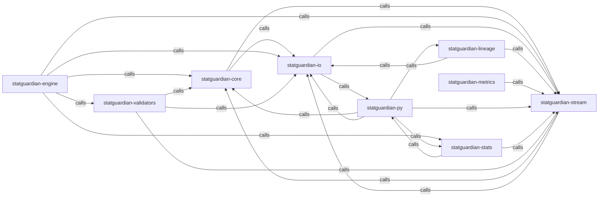

_Generated by CodeAtlas._

## Details

Owns 0 symbols across 0 file(s).

### statguardian-core

Owns 0 symbols across 1 file(s).

**Related Classes/Methods:** _None_

### statguardian-engine

Owns 0 symbols across 1 file(s).

**Related Classes/Methods:** _None_

### statguardian-io

Owns 0 symbols across 1 file(s).

**Related Classes/Methods:** _None_

### statguardian-lineage

Owns 0 symbols across 1 file(s).

**Related Classes/Methods:** _None_

### statguardian-metrics

Owns 0 symbols across 1 file(s).

**Related Classes/Methods:** _None_

### statguardian-py

Owns 0 symbols across 1 file(s).

**Related Classes/Methods:** _None_

### statguardian-stats

Owns 0 symbols across 1 file(s).

**Related Classes/Methods:** _None_

### statguardian-stream

Owns 0 symbols across 1 file(s).

**Related Classes/Methods:** _None_

### statguardian-validators

Owns 0 symbols across 1 file(s).

**Related Classes/Methods:** _None_
