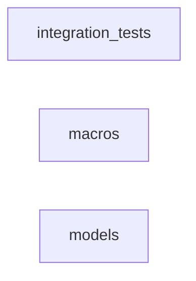

_Generated by CodeAtlas._

## Details

Owns 0 symbols across 2 file(s).

### integration_tests

Owns 0 symbols across 4 file(s).

**Related Classes/Methods:** _None_

### macros

Owns 0 symbols across 5 file(s).

**Related Classes/Methods:** _None_

### models

Owns 0 symbols across 5 file(s).

**Related Classes/Methods:** _None_
