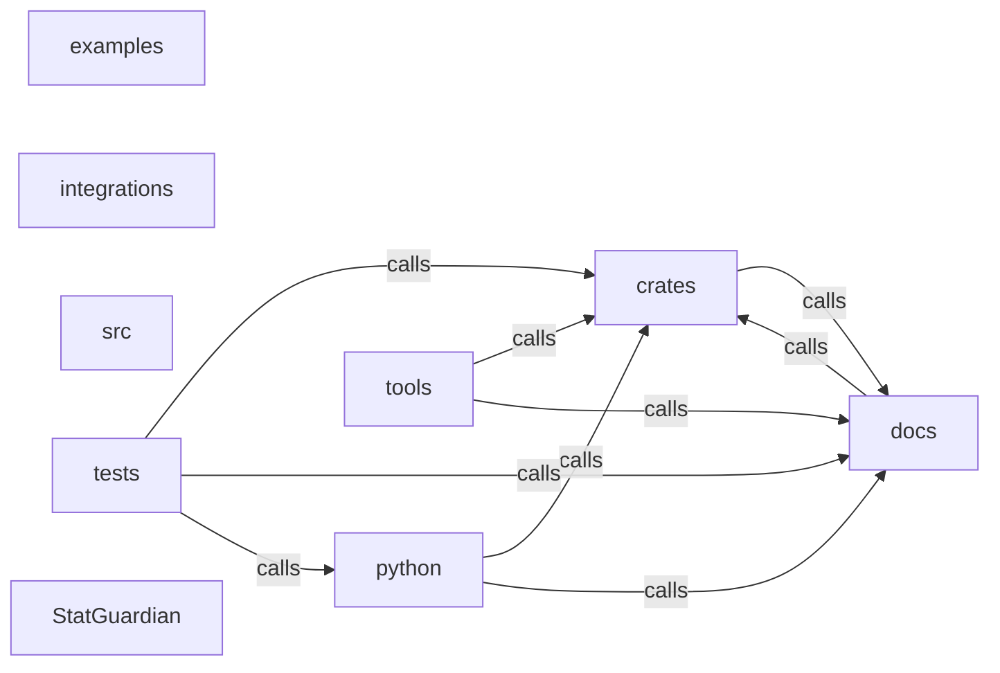

_Generated by CodeAtlas._

## Details

Architecture map of StatGuardian.

### crates

Owns 0 symbols across 0 file(s).

**Related Classes/Methods:** _None_

### docs

Owns 0 symbols across 12 file(s).

**Related Classes/Methods:** _None_

### examples

Owns 0 symbols across 4 file(s).

**Related Classes/Methods:** _None_

### integrations

Owns 0 symbols across 0 file(s).

**Related Classes/Methods:** _None_

### python

Owns 0 symbols across 0 file(s).

**Related Classes/Methods:** _None_

### src

Owns 0 symbols across 0 file(s).

**Related Classes/Methods:** _None_

### tests

Owns 109 symbols across 10 file(s).

**Related Classes/Methods:** _None_

**Source Files:**

- `tests/integration_test.rs`
  - `tests.integration_test.engine_from_dsl`
  - `tests.integration_test.make_clean_df`
  - `tests.integration_test.make_dirty_df`
  - `tests.integration_test.test_batch_executor_consistent_across_manual_splits`
  - `tests.integration_test.test_clean_data_passes_with_high_score`
  - `tests.integration_test.test_column_profiling`
  - `tests.integration_test.test_dirty_data_produces_violations`
  - `tests.integration_test.test_drift_detection`
  - `tests.integration_test.test_drift_detection_catches_large_shift`
  - `tests.integration_test.test_health_score_degrades_with_violations`
  - `tests.integration_test.test_multiple_contracts_in_dsl`
  - `tests.integration_test.test_report_json_is_valid`
  - `tests.integration_test.test_report_prometheus_output`
  - `tests.integration_test.test_violation_categories`
- `tests/test_codeatlas_adapter.py`
  - `tests.test_codeatlas_adapter._run`
  - `tests.test_codeatlas_adapter.test_check_reports_the_embedded_engine_available`
  - `tests.test_codeatlas_adapter.test_diagnose_summarises_the_architecture_map`
  - `tests.test_codeatlas_adapter.test_explain_reports_an_unknown_node_as_an_error`
  - `tests.test_codeatlas_adapter.test_god_nodes_are_ranked_by_degree`
- `tests/test_lineage.py`
  - `tests.test_lineage.TestImpactChain`
  - `tests.test_lineage.TestImpactChain.test_impact_chain_reflects_real_saved_topology`
  - `tests.test_lineage.TestLineageChangesAndHistory`
  - `tests.test_lineage.TestLineageChangesAndHistory.test_change_severity_is_derived_from_worst_change`
  - `tests.test_lineage.TestLineageChangesAndHistory.test_history_only_includes_versions_that_touched_the_table`
  - `tests.test_lineage.TestLineageChangesAndHistory.test_history_respects_limit_by_scanning_only_recent_versions`
  - `tests.test_lineage.TestLineageRoundTrip`
  - `tests.test_lineage.TestLineageRoundTrip.test_get_lineage_graph_is_empty_before_any_version_saved`
  - `tests.test_lineage.TestLineageRoundTrip.test_get_lineage_version_returns_none_when_nothing_saved`
  - `tests.test_lineage.TestLineageRoundTrip.test_get_specific_version_by_number`
  - `tests.test_lineage.TestLineageRoundTrip.test_saved_graph_is_retrievable_with_real_nodes_and_edges`
  - `tests.test_lineage.TestLineageRoundTrip.test_separate_warehouses_do_not_share_lineage`
  - `tests.test_lineage.TestLineageRoundTrip.test_version_numbers_auto_increment`
  - `tests.test_lineage._build_two_stage_graph`
  - `tests.test_lineage.warehouse_config`
- `tests/test_okf_contracts.py`
  - `tests.test_okf_contracts.TestOKFAnomalyPattern`
  - `tests.test_okf_contracts.TestOKFAnomalyPattern.test_anomaly_filtering`
  - `tests.test_okf_contracts.TestOKFAnomalyPattern.test_drift_anomaly`
  - `tests.test_okf_contracts.TestOKFAnomalyPattern.test_get_recurring_anomalies`
  - `tests.test_okf_contracts.TestOKFAnomalyPattern.test_record_anomaly`
  - `tests.test_okf_contracts.TestOKFContractCatalog`
  - `tests.test_okf_contracts.TestOKFContractCatalog.test_catalog_structure`
  - `tests.test_okf_contracts.TestOKFContractCatalog.test_get_baseline`
  - `tests.test_okf_contracts.TestOKFContractCatalog.test_save_contract`
  - `tests.test_okf_contracts.TestOKFContractCatalog.test_search_by_tag`
  - `tests.test_okf_contracts.TestOKFContractCatalog.test_search_contracts`
  - `tests.test_okf_contracts.TestOKFContractCatalog.test_update_baseline`
  - `tests.test_okf_contracts.TestOKFContractDocument`
  - `tests.test_okf_contracts.TestOKFContractDocument.test_contract_properties`
  - `tests.test_okf_contracts.TestOKFContractDocument.test_load_contract`
  - `tests.test_okf_contracts.TestOKFRuleEffectiveness`
  - `tests.test_okf_contracts.TestOKFRuleEffectiveness.test_get_success_rate`
  - `tests.test_okf_contracts.TestOKFRuleEffectiveness.test_no_history`
  - `tests.test_okf_contracts.TestOKFRuleEffectiveness.test_record_failed_execution`
  - `tests.test_okf_contracts.TestOKFRuleEffectiveness.test_record_rule_execution`
  - `tests.test_okf_contracts.populated_catalog`
  - `tests.test_okf_contracts.temp_catalog`
- `tests/test_parser.rs`
  - `tests.test_parser.test_between_constraint`
  - `tests.test_parser.test_constraint_ordering`
  - `tests.test_parser.test_error_on_invalid_syntax`
  - `tests.test_parser.test_error_on_unknown_type`
  - `tests.test_parser.test_parse_all_supported_types`
  - `tests.test_parser.test_parse_multiple_datasets`
  - `tests.test_parser.test_parse_preserves_dataset_name`
  - `tests.test_parser.test_parse_simple_dataset`
  - `tests.test_parser.test_parse_with_schema_constraints`
  - `tests.test_parser.test_regex_constraint`
- `tests/test_python_bindings.py`
  - `tests.test_python_bindings._run_cli`
  - `tests.test_python_bindings._write`
  - `tests.test_python_bindings.test_execute_end_to_end_through_python_bindings`
  - `tests.test_python_bindings.test_execute_stream_ndjson_clean`
  - `tests.test_python_bindings.test_execute_stream_ndjson_limits`
  - `tests.test_python_bindings.test_execute_stream_ndjson_malformed_mapping_and_fail_fast`
  - `tests.test_python_bindings.test_execute_stream_ndjson_missing_column_is_blocking`
  - `tests.test_python_bindings.test_execute_stream_ndjson_nonblocking_needs_fail_on_warning`
  - `tests.test_python_bindings.test_from_dsl_enforces_validator_at_binding_boundary`
  - `tests.test_python_bindings.test_from_file_enforces_validator`
  - `tests.test_python_bindings.test_statguardian_import`
  - `tests.test_python_bindings.test_statguardian_version`
  - `tests.test_python_bindings.test_stream_cli_exit_codes_and_stream_separation`
- `tests/test_security.rs`
  - `tests.test_security.test_case_insensitivity_of_keywords`
  - `tests.test_security.test_comment_injection_prevention`
  - `tests.test_security.test_conflicting_constraints`
  - `tests.test_security.test_constraint_with_extreme_values`
  - `tests.test_security.test_duplicate_constraint_specification`
  - `tests.test_security.test_empty_constraint_value`
  - `tests.test_security.test_invalid_type_names`
  - `tests.test_security.test_line_continuation`
  - `tests.test_security.test_malformed_regex_pattern`
  - `tests.test_security.test_many_fields_in_schema`
  - `tests.test_security.test_nested_query_depth_limit`
  - `tests.test_security.test_parser_input_size_limit`
  - `tests.test_security.test_parser_recovery_from_partial_schema`
  - `tests.test_security.test_parser_with_max_allowed_size`
  - `tests.test_security.test_semicolon_handling`
  - `tests.test_security.test_special_characters_in_constraint`
  - `tests.test_security.test_unbalanced_braces`
  - `tests.test_security.test_unicode_in_dataset_name`
  - `tests.test_security.test_whitespace_handling`
- `tests/test_streaming.rs`
  - `tests.test_streaming.engine`
  - `tests.test_streaming.execute_streaming_batches_are_bounded_by_batch_size_throughout_the_file`
  - `tests.test_streaming.execute_streaming_matches_whole_file_execution`
  - `tests.test_streaming.streaming_cost_does_not_scale_with_batch_count`
  - `tests.test_streaming.write_csv`
- `tests/test_validators.rs`
  - `tests.test_validators.test_constraints_recognized`
  - `tests.test_validators.test_empty_dataframe_handling`
  - `tests.test_validators.test_large_dataset_processing`
  - `tests.test_validators.test_multiple_schema_fields`
  - `tests.test_validators.test_parser_and_engine_basic`
  - `tests.test_validators.test_validation_on_valid_data`

### tools

Owns 0 symbols across 0 file(s).

**Related Classes/Methods:** _None_

### StatGuardian

Owns 0 symbols across 14 file(s).

**Related Classes/Methods:** _None_
