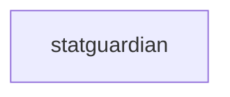

_Generated by CodeAtlas._

## Details

Owns 0 symbols across 0 file(s).

### statguardian

Owns 137 symbols across 17 file(s).

**Related Classes/Methods:** _None_

**Source Files:**

- `python/statguardian/_anomaly_detection.py`
  - `python.statguardian._anomaly_detection.AdaptiveThresholdDetector`
  - `python.statguardian._anomaly_detection.AdaptiveThresholdDetector.__init__`
  - `python.statguardian._anomaly_detection.AdaptiveThresholdDetector.add_observation`
  - `python.statguardian._anomaly_detection.AdaptiveThresholdDetector.detect_hourly_anomaly`
  - `python.statguardian._anomaly_detection.AdaptiveThresholdDetector.detect_seasonal_anomaly`
  - `python.statguardian._anomaly_detection.AnomalyDetectionEngine`
  - `python.statguardian._anomaly_detection.AnomalyDetectionEngine.__init__`
  - `python.statguardian._anomaly_detection.AnomalyDetectionEngine.batch_check`
  - `python.statguardian._anomaly_detection.AnomalyDetectionEngine.check_metric`
  - `python.statguardian._anomaly_detection.AnomalyDetectionEngine.get_anomalies_only`
  - `python.statguardian._anomaly_detection.AnomalyResult`
  - `python.statguardian._anomaly_detection.SimpleMovingAverageDetector`
  - `python.statguardian._anomaly_detection.SimpleMovingAverageDetector.__init__`
  - `python.statguardian._anomaly_detection.SimpleMovingAverageDetector._get_reason`
  - `python.statguardian._anomaly_detection.SimpleMovingAverageDetector.add_observation`
  - `python.statguardian._anomaly_detection.SimpleMovingAverageDetector.detect_anomaly`
- `python/statguardian/_cli.py`
  - `python.statguardian._cli._cmd_check`
  - `python.statguardian._cli._cmd_stream`
  - `python.statguardian._cli._cmd_validate`
  - `python.statguardian._cli.main`
- `python/statguardian/_connectors.py`
  - `python.statguardian._connectors._check_oss`
  - `python.statguardian._connectors._read_sql_to_polars`
  - `python.statguardian._connectors.execute_cloud`
  - `python.statguardian._connectors.execute_spark`
  - `python.statguardian._connectors.execute_spark._spark_to_polars`
  - `python.statguardian._connectors.execute_sql`
- `python/statguardian/_dbt.py`
  - `python.statguardian._dbt.DbtIntegrationError`
  - `python.statguardian._dbt._render_env_vars`
  - `python.statguardian._dbt._render_env_vars._sub`
  - `python.statguardian._dbt._write_result_row`
  - `python.statguardian._dbt.build_connection_string`
  - `python.statguardian._dbt.cmd_dbt_validate`
  - `python.statguardian._dbt.contracted_models`
  - `python.statguardian._dbt.load_dbt_project`
  - `python.statguardian._dbt.load_manifest`
  - `python.statguardian._dbt.load_profile`
  - `python.statguardian._dbt.relation_for_node`
  - `python.statguardian._dbt.resolve_target`
- `python/statguardian/_dsl_validator.py`
  - `python.statguardian._dsl_validator.validate_dataset_name`
  - `python.statguardian._dsl_validator.validate_dsl_contract`
- `python/statguardian/_evolution.py`
  - `python.statguardian._evolution.SchemaChange`
  - `python.statguardian._evolution.SchemaChange.__str__`
  - `python.statguardian._evolution.assert_no_breaking_changes`
  - `python.statguardian._evolution.detect_schema_changes`
  - `python.statguardian._evolution.detect_schema_changes.to_schema`
  - `python.statguardian._evolution.schema_evolution_report`
- `python/statguardian/_gpu.py`
  - `python.statguardian._gpu._cudf_to_polars`
  - `python.statguardian._gpu.execute_cudf`
  - `python.statguardian._gpu.is_cudf_available`
- `python/statguardian/_html.py`
  - `python.statguardian._html._badge`
  - `python.statguardian._html._grade_color`
  - `python.statguardian._html._render`
  - `python.statguardian._html._sev_color`
  - `python.statguardian._html.to_html`
- `python/statguardian/_integrity.py`
  - `python.statguardian._integrity.IntegrityViolation`
  - `python.statguardian._integrity.IntegrityViolation.__str__`
  - `python.statguardian._integrity.check_all_foreign_keys`
  - `python.statguardian._integrity.check_referential_integrity`
  - `python.statguardian._integrity.integrity_report`
- `python/statguardian/_lineage.py`
  - `python.statguardian._lineage.LineageChange`
  - `python.statguardian._lineage.LineageEdge`
  - `python.statguardian._lineage.LineageGraph`
  - `python.statguardian._lineage.LineageGraph.add_edge`
  - `python.statguardian._lineage.LineageGraph.add_node`
  - `python.statguardian._lineage.LineageGraph.get_downstream`
  - `python.statguardian._lineage.LineageGraph.get_impact_chain`
  - `python.statguardian._lineage.LineageGraph.get_node`
  - `python.statguardian._lineage.LineageGraph.get_upstream`
  - `python.statguardian._lineage.LineageGraph.size`
  - `python.statguardian._lineage.LineageNode`
  - `python.statguardian._lineage.LineageNode.cache_key`
  - `python.statguardian._lineage.LineageNode.qualified_name`
  - `python.statguardian._lineage.LineageVersion`
  - `python.statguardian._lineage._lineage_db_path`
  - `python.statguardian._lineage._utcnow_iso`
  - `python.statguardian._lineage.create_lineage_edge`
  - `python.statguardian._lineage.create_lineage_node`
  - `python.statguardian._lineage.get_lineage_graph`
  - `python.statguardian._lineage.get_lineage_history`
  - `python.statguardian._lineage.get_lineage_version`
  - `python.statguardian._lineage.lineage_edge_from_dict`
  - `python.statguardian._lineage.lineage_graph_from_dict`
  - `python.statguardian._lineage.lineage_node_from_dict`
  - `python.statguardian._lineage.lineage_version_from_dict`
  - `python.statguardian._lineage.save_lineage_version`
- `python/statguardian/_parallel.py`
  - `python.statguardian._parallel.FileResult`
  - `python.statguardian._parallel.FileResult.failed`
  - `python.statguardian._parallel.FileResult.passed`
  - `python.statguardian._parallel._resolve_paths`
  - `python.statguardian._parallel._validate_one`
  - `python.statguardian._parallel.execute_files`
  - `python.statguardian._parallel.execute_files_stream`
- `python/statguardian/_pii.py`
  - `python.statguardian._pii.PiiFinding`
  - `python.statguardian._pii.PiiFinding.__str__`
  - `python.statguardian._pii.pii_report`
  - `python.statguardian._pii.scan_pii`
- `python/statguardian/_validators.py`
  - `python.statguardian._validators.MergedReport`
  - `python.statguardian._validators.MergedReport.summary`
  - `python.statguardian._validators.clear_validators`
  - `python.statguardian._validators.list_validators`
  - `python.statguardian._validators.merge_violations`
  - `python.statguardian._validators.run_custom_validators`
  - `python.statguardian._validators.validator`
  - `python.statguardian._validators.validator.decorator`
- `python/statguardian/error_messages.py`
  - `python.statguardian.error_messages.ValidationErrorMessage`
  - `python.statguardian.error_messages.ValidationErrorMessage.__init__`
  - `python.statguardian.error_messages.ValidationErrorMessage.__str__`
  - `python.statguardian.error_messages.ValidationErrorMessage.format`
  - `python.statguardian.error_messages.get_schema_error`
  - `python.statguardian.error_messages.get_type_error`
- `python/statguardian/okf_contracts.py`
  - `python.statguardian.okf_contracts.OKFAnomalyPattern`
  - `python.statguardian.okf_contracts.OKFAnomalyPattern.__init__`
  - `python.statguardian.okf_contracts.OKFAnomalyPattern.get_recurring_anomalies`
  - `python.statguardian.okf_contracts.OKFAnomalyPattern.record_anomaly`
  - `python.statguardian.okf_contracts.OKFContractCatalog`
  - `python.statguardian.okf_contracts.OKFContractCatalog.__init__`
  - `python.statguardian.okf_contracts.OKFContractCatalog._ensure_structure`
  - `python.statguardian.okf_contracts.OKFContractCatalog._load_all`
  - `python.statguardian.okf_contracts.OKFContractCatalog.get_baseline`
  - `python.statguardian.okf_contracts.OKFContractCatalog.get_contract`
  - `python.statguardian.okf_contracts.OKFContractCatalog.reload`
  - `python.statguardian.okf_contracts.OKFContractCatalog.save_baseline`
  - `python.statguardian.okf_contracts.OKFContractCatalog.save_contract`
  - `python.statguardian.okf_contracts.OKFContractCatalog.search_contracts`
  - `python.statguardian.okf_contracts.OKFContractDocument`
  - `python.statguardian.okf_contracts.OKFContractDocument.__init__`
  - `python.statguardian.okf_contracts.OKFContractDocument.baseline`
  - `python.statguardian.okf_contracts.OKFContractDocument.contract_name`
  - `python.statguardian.okf_contracts.OKFContractDocument.get_metadata`
  - `python.statguardian.okf_contracts.OKFContractDocument.rules`
  - `python.statguardian.okf_contracts.OKFContractDocument.schema`
  - `python.statguardian.okf_contracts.OKFContractDocument.tags`
  - `python.statguardian.okf_contracts.OKFContractDocument.version`
  - `python.statguardian.okf_contracts.OKFRuleEffectiveness`
  - `python.statguardian.okf_contracts.OKFRuleEffectiveness.__init__`
  - `python.statguardian.okf_contracts.OKFRuleEffectiveness.get_rule_success_rate`
  - `python.statguardian.okf_contracts.OKFRuleEffectiveness.record_rule_execution`
