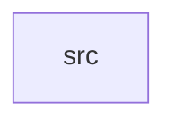

_Generated by CodeAtlas._

## Details

Owns 0 symbols across 1 file(s).

### src

Owns 48 symbols across 4 file(s).

**Related Classes/Methods:** _None_

**Source Files:**

- `crates/statguardian-core/src/ast.rs`
  - `crates.statguardian-core.src.ast.AnomalyFn`
  - `crates.statguardian-core.src.ast.AnomalyRule`
  - `crates.statguardian-core.src.ast.ComparisonOp`
  - `crates.statguardian-core.src.ast.ComparisonOp.evaluate`
  - `crates.statguardian-core.src.ast.ComparisonOp.evaluate_bool`
  - `crates.statguardian-core.src.ast.ComparisonOp.evaluate_str`
  - `crates.statguardian-core.src.ast.ComparisonOp.fmt`
  - `crates.statguardian-core.src.ast.Constraint`
  - `crates.statguardian-core.src.ast.CrossColumnRule`
  - `crates.statguardian-core.src.ast.DataContract`
  - `crates.statguardian-core.src.ast.DataContract.is_streaming`
  - `crates.statguardian-core.src.ast.DataContract.new`
  - `crates.statguardian-core.src.ast.DataContract.schema_map`
  - `crates.statguardian-core.src.ast.DataType`
  - `crates.statguardian-core.src.ast.DataType.fmt`
  - `crates.statguardian-core.src.ast.FieldDef`
  - `crates.statguardian-core.src.ast.LiteralValue`
  - `crates.statguardian-core.src.ast.LiteralValue.fmt`
  - `crates.statguardian-core.src.ast.MetricFn`
  - `crates.statguardian-core.src.ast.QualityRule`
  - `crates.statguardian-core.src.ast.Severity`
  - `crates.statguardian-core.src.ast.StatFn`
  - `crates.statguardian-core.src.ast.StatFn.fmt`
  - `crates.statguardian-core.src.ast.StatsRule`
  - `crates.statguardian-core.src.ast.StreamConfig`
- `crates/statguardian-core/src/error.rs`
  - `crates.statguardian-core.src.error.CoreError`
- `crates/statguardian-core/src/lib.rs`
  - `crates.statguardian-core.src.lib.parse_and_compile`
- `crates/statguardian-core/src/streaming.rs`
  - `crates.statguardian-core.src.streaming.SlidingWindowExecutor`
  - `crates.statguardian-core.src.streaming.SlidingWindowExecutor.evict_expired`
  - `crates.statguardian-core.src.streaming.SlidingWindowExecutor.get_windows_for_event`
  - `crates.statguardian-core.src.streaming.SlidingWindowExecutor.new`
  - `crates.statguardian-core.src.streaming.StreamConfig`
  - `crates.statguardian-core.src.streaming.StreamingWindow`
  - `crates.statguardian-core.src.streaming.StreamingWindow.add_event`
  - `crates.statguardian-core.src.streaming.StreamingWindow.close`
  - `crates.statguardian-core.src.streaming.StreamingWindow.event_count`
  - `crates.statguardian-core.src.streaming.StreamingWindow.new`
  - `crates.statguardian-core.src.streaming.TumblingWindowExecutor`
  - `crates.statguardian-core.src.streaming.TumblingWindowExecutor.close_windows_before`
  - `crates.statguardian-core.src.streaming.TumblingWindowExecutor.get_closed_windows`
  - `crates.statguardian-core.src.streaming.TumblingWindowExecutor.get_window_for_event`
  - `crates.statguardian-core.src.streaming.TumblingWindowExecutor.new`
  - `crates.statguardian-core.src.streaming.WindowType`
  - `crates.statguardian-core.src.streaming.tests.test_sliding_window_bounded_memory_long_running_stream`
  - `crates.statguardian-core.src.streaming.tests.test_sliding_window_evict_expired_removes_old_windows`
  - `crates.statguardian-core.src.streaming.tests.test_tumbling_window_creation`
  - `crates.statguardian-core.src.streaming.tests.test_window_add_event`
  - `crates.statguardian-core.src.streaming.tests.test_window_reject_out_of_bounds`
