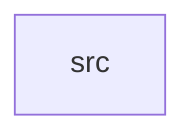

_Generated by CodeAtlas._

## Details

Owns 0 symbols across 1 file(s).

### src

Owns 15 symbols across 2 file(s).

**Related Classes/Methods:** _None_

**Source Files:**

- `crates/statguardian-engine/src/batch.rs`
  - `crates.statguardian-engine.src.batch.BatchExecutor`
  - `crates.statguardian-engine.src.batch.BatchExecutor.execute`
  - `crates.statguardian-engine.src.batch.detect_outliers`
  - `crates.statguardian-engine.src.batch.execute_node`
  - `crates.statguardian-engine.src.batch.get_series`
- `crates/statguardian-engine/src/lib.rs`
  - `crates.statguardian-engine.src.lib.Engine`
  - `crates.statguardian-engine.src.lib.Engine.execute`
  - `crates.statguardian-engine.src.lib.Engine.execute_file`
  - `crates.statguardian-engine.src.lib.Engine.execute_streaming`
  - `crates.statguardian-engine.src.lib.Engine.new`
  - `crates.statguardian-engine.src.lib.run`
  - `crates.statguardian-engine.src.lib.tests.make_users_df`
  - `crates.statguardian-engine.src.lib.tests.test_convenience_run`
  - `crates.statguardian-engine.src.lib.tests.test_engine_detects_violations`
  - `crates.statguardian-engine.src.lib.tests.test_engine_passes_clean_data`
