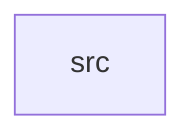

_Generated by CodeAtlas._

## Details

Owns 0 symbols across 1 file(s).

### src

Owns 99 symbols across 5 file(s).

**Related Classes/Methods:** _None_

**Source Files:**

- `crates/statguardian-io/src/cloud.rs`
  - `crates.statguardian-io.src.cloud.CloudReader`
  - `crates.statguardian-io.src.cloud.CloudReader.read`
  - `crates.statguardian-io.src.cloud.CloudReader.read_csv`
  - `crates.statguardian-io.src.cloud.CloudReader.read_ipc`
  - `crates.statguardian-io.src.cloud.CloudReader.read_ndjson`
  - `crates.statguardian-io.src.cloud.CloudReader.read_parquet`
  - `crates.statguardian-io.src.cloud.is_cloud_uri`
  - `crates.statguardian-io.src.cloud.tests.test_format_inference_from_uri`
  - `crates.statguardian-io.src.cloud.tests.test_is_cloud_uri`
- `crates/statguardian-io/src/delta.rs`
  - `crates.statguardian-io.src.delta.DeltaAction`
  - `crates.statguardian-io.src.delta.DeltaAdd`
  - `crates.statguardian-io.src.delta.DeltaReader`
  - `crates.statguardian-io.src.delta.DeltaReader.find_version_for_timestamp`
  - `crates.statguardian-io.src.delta.DeltaReader.read`
  - `crates.statguardian-io.src.delta.DeltaReader.read_as_of_timestamp`
  - `crates.statguardian-io.src.delta.DeltaReader.read_two_versions`
  - `crates.statguardian-io.src.delta.DeltaReader.read_version`
  - `crates.statguardian-io.src.delta.DeltaReader.resolve_active_files`
  - `crates.statguardian-io.src.delta.DeltaRemove`
  - `crates.statguardian-io.src.delta.read_and_concat`
  - `crates.statguardian-io.src.delta.tests.tempdir`
  - `crates.statguardian-io.src.delta.tests.test_resolve_active_files_add`
  - `crates.statguardian-io.src.delta.tests.test_resolve_respects_version_limit`
  - `crates.statguardian-io.src.delta.tests.write_delta_add`
  - `crates.statguardian-io.src.delta.url_decode`
  - `crates.statguardian-io.src.delta.vstack_all`
- `crates/statguardian-io/src/iceberg.rs`
  - `crates.statguardian-io.src.iceberg.IcebergDataFile`
  - `crates.statguardian-io.src.iceberg.IcebergMetadata`
  - `crates.statguardian-io.src.iceberg.IcebergReader`
  - `crates.statguardian-io.src.iceberg.IcebergReader.list_snapshots`
  - `crates.statguardian-io.src.iceberg.IcebergReader.read`
  - `crates.statguardian-io.src.iceberg.IcebergReader.read_as_of_timestamp`
  - `crates.statguardian-io.src.iceberg.IcebergReader.read_ref`
  - `crates.statguardian-io.src.iceberg.IcebergReader.read_snapshot`
  - `crates.statguardian-io.src.iceberg.IcebergReader.read_two_snapshots`
  - `crates.statguardian-io.src.iceberg.IcebergRef`
  - `crates.statguardian-io.src.iceberg.IcebergSnapshot`
  - `crates.statguardian-io.src.iceberg.SnapshotInfo`
  - `crates.statguardian-io.src.iceberg.collect_data_files`
  - `crates.statguardian-io.src.iceberg.collect_from_json_manifest_list`
  - `crates.statguardian-io.src.iceberg.collect_from_manifest_list`
  - `crates.statguardian-io.src.iceberg.collect_manifests_from_directory`
  - `crates.statguardian-io.src.iceberg.find_latest_metadata_file`
  - `crates.statguardian-io.src.iceberg.find_snapshot_at_timestamp`
  - `crates.statguardian-io.src.iceberg.load_data_files`
  - `crates.statguardian-io.src.iceberg.load_metadata`
  - `crates.statguardian-io.src.iceberg.read_manifest`
  - `crates.statguardian-io.src.iceberg.read_manifest_json`
  - `crates.statguardian-io.src.iceberg.resolve_path`
  - `crates.statguardian-io.src.iceberg.resolve_snapshot`
  - `crates.statguardian-io.src.iceberg.scan_data_directory`
  - `crates.statguardian-io.src.iceberg.tests.test_resolve_path_absolute`
  - `crates.statguardian-io.src.iceberg.tests.test_resolve_path_file_uri`
  - `crates.statguardian-io.src.iceberg.tests.test_resolve_path_relative`
  - `crates.statguardian-io.src.iceberg.vstack_all`
  - `crates.statguardian-io.src.iceberg.walkdir_parquet`
- `crates/statguardian-io/src/lib.rs`
  - `crates.statguardian-io.src.lib.DataReader`
  - `crates.statguardian-io.src.lib.DataReader.from_json_bytes`
  - `crates.statguardian-io.src.lib.DataReader.read_avro`
  - `crates.statguardian-io.src.lib.DataReader.read_cloud`
  - `crates.statguardian-io.src.lib.DataReader.read_csv`
  - `crates.statguardian-io.src.lib.DataReader.read_delta`
  - `crates.statguardian-io.src.lib.DataReader.read_file`
  - `crates.statguardian-io.src.lib.DataReader.read_iceberg`
  - `crates.statguardian-io.src.lib.DataReader.read_ipc`
  - `crates.statguardian-io.src.lib.DataReader.read_json`
  - `crates.statguardian-io.src.lib.DataReader.read_orc`
  - `crates.statguardian-io.src.lib.DataReader.read_parquet`
  - `crates.statguardian-io.src.lib.DataReader.read_sql`
  - `crates.statguardian-io.src.lib.IoError`
  - `crates.statguardian-io.src.lib.RowBuffer`
  - `crates.statguardian-io.src.lib.RowBuffer.buffered_count`
  - `crates.statguardian-io.src.lib.RowBuffer.flush`
  - `crates.statguardian-io.src.lib.RowBuffer.new`
  - `crates.statguardian-io.src.lib.RowBuffer.push`
  - `crates.statguardian-io.src.lib.StreamingBatcher`
  - `crates.statguardian-io.src.lib.StreamingBatcher.is_bounded_memory`
  - `crates.statguardian-io.src.lib.StreamingBatcher.new`
  - `crates.statguardian-io.src.lib.StreamingBatcher.next_batch`
  - `crates.statguardian-io.src.lib.open`
  - `crates.statguardian-io.src.lib.tests.csv_streaming_opens_the_source_file_exactly_once`
  - `crates.statguardian-io.src.lib.tests.csv_streaming_yields_all_rows_across_many_batches`
  - `crates.statguardian-io.src.lib.tests.empty_batcher_yields_nothing`
  - `crates.statguardian-io.src.lib.tests.non_incremental_formats_are_flagged_and_still_read_only_once`
  - `crates.statguardian-io.src.lib.tests.parquet_streaming_yields_all_rows_and_opens_once`
  - `crates.statguardian-io.src.lib.tests.write_csv`
  - `crates.statguardian-io.src.lib.tests.write_parquet`
- `crates/statguardian-io/src/sql.rs`
  - `crates.statguardian-io.src.sql.SqlBackend`
  - `crates.statguardian-io.src.sql.SqlBackend.from_url`
  - `crates.statguardian-io.src.sql.SqlBackend.is_rust_native`
  - `crates.statguardian-io.src.sql.SqlReader`
  - `crates.statguardian-io.src.sql.SqlReader.read`
  - `crates.statguardian-io.src.sql.SqlReader.read_mysql`
  - `crates.statguardian-io.src.sql.SqlReader.read_postgres`
  - `crates.statguardian-io.src.sql.SqlReader.read_sqlite`
  - `crates.statguardian-io.src.sql.build_runtime`
  - `crates.statguardian-io.src.sql.fetch_to_dataframe`
  - `crates.statguardian-io.src.sql.tests.test_backend_detection`
  - `crates.statguardian-io.src.sql.tests.test_unsupported_backend_returns_helpful_error`
