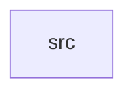

_Generated by CodeAtlas._

## Details

Owns 0 symbols across 1 file(s).

### src

Owns 59 symbols across 3 file(s).

**Related Classes/Methods:** _None_

**Source Files:**

- `crates/statguardian-lineage/src/model.rs`
  - `crates.statguardian-lineage.src.model.ChangeSeverity`
  - `crates.statguardian-lineage.src.model.ChangeSeverity.fmt`
  - `crates.statguardian-lineage.src.model.ChangeType`
  - `crates.statguardian-lineage.src.model.ChangeType.fmt`
  - `crates.statguardian-lineage.src.model.LineageChange`
  - `crates.statguardian-lineage.src.model.LineageChange.new`
  - `crates.statguardian-lineage.src.model.LineageEdge`
  - `crates.statguardian-lineage.src.model.LineageEdge.new`
  - `crates.statguardian-lineage.src.model.LineageGraph`
  - `crates.statguardian-lineage.src.model.LineageGraph.add_edge`
  - `crates.statguardian-lineage.src.model.LineageGraph.add_node`
  - `crates.statguardian-lineage.src.model.LineageGraph.get_downstream`
  - `crates.statguardian-lineage.src.model.LineageGraph.get_impact_chain`
  - `crates.statguardian-lineage.src.model.LineageGraph.get_node`
  - `crates.statguardian-lineage.src.model.LineageGraph.get_upstream`
  - `crates.statguardian-lineage.src.model.LineageGraph.new`
  - `crates.statguardian-lineage.src.model.LineageGraph.size`
  - `crates.statguardian-lineage.src.model.LineageNode`
  - `crates.statguardian-lineage.src.model.LineageNode.cache_key`
  - `crates.statguardian-lineage.src.model.LineageNode.new`
  - `crates.statguardian-lineage.src.model.LineageNode.qualified_name`
  - `crates.statguardian-lineage.src.model.LineageVersion`
  - `crates.statguardian-lineage.src.model.LineageVersion.new`
  - `crates.statguardian-lineage.src.model.tests.test_change_severity_ordering`
  - `crates.statguardian-lineage.src.model.tests.test_empty_graph`
  - `crates.statguardian-lineage.src.model.tests.test_fan_in_lineage`
  - `crates.statguardian-lineage.src.model.tests.test_fan_out_lineage`
  - `crates.statguardian-lineage.src.model.tests.test_graph_with_columns`
  - `crates.statguardian-lineage.src.model.tests.test_impact_chain`
  - `crates.statguardian-lineage.src.model.tests.test_lineage_change_creation`
  - `crates.statguardian-lineage.src.model.tests.test_lineage_edge_creation`
  - `crates.statguardian-lineage.src.model.tests.test_lineage_graph_operations`
  - `crates.statguardian-lineage.src.model.tests.test_lineage_node_creation`
  - `crates.statguardian-lineage.src.model.tests.test_lineage_version_creation`
  - `crates.statguardian-lineage.src.model.tests.test_multi_stage_lineage`
  - `crates.statguardian-lineage.src.model.tests.test_serialization`
- `crates/statguardian-lineage/src/storage.rs`
  - `crates.statguardian-lineage.src.storage.LineageStore`
  - `crates.statguardian-lineage.src.storage.SQLiteLineageStore`
  - `crates.statguardian-lineage.src.storage.SQLiteLineageStore.get_changes`
  - `crates.statguardian-lineage.src.storage.SQLiteLineageStore.get_latest_version`
  - `crates.statguardian-lineage.src.storage.SQLiteLineageStore.get_version`
  - `crates.statguardian-lineage.src.storage.SQLiteLineageStore.init_schema`
  - `crates.statguardian-lineage.src.storage.SQLiteLineageStore.list_versions`
  - `crates.statguardian-lineage.src.storage.SQLiteLineageStore.memory`
  - `crates.statguardian-lineage.src.storage.SQLiteLineageStore.new`
  - `crates.statguardian-lineage.src.storage.SQLiteLineageStore.save_change`
  - `crates.statguardian-lineage.src.storage.SQLiteLineageStore.save_version`
  - `crates.statguardian-lineage.src.storage.tests.test_change_severity_persistence`
  - `crates.statguardian-lineage.src.storage.tests.test_get_latest_version`
  - `crates.statguardian-lineage.src.storage.tests.test_list_versions`
  - `crates.statguardian-lineage.src.storage.tests.test_multiple_changes_per_version`
  - `crates.statguardian-lineage.src.storage.tests.test_multiple_versions_same_warehouse`
  - `crates.statguardian-lineage.src.storage.tests.test_multiple_warehouses`
  - `crates.statguardian-lineage.src.storage.tests.test_nonexistent_version`
  - `crates.statguardian-lineage.src.storage.tests.test_save_and_retrieve_changes`
  - `crates.statguardian-lineage.src.storage.tests.test_save_and_retrieve_version`
  - `crates.statguardian-lineage.src.storage.tests.test_sqlite_store_creation`
  - `crates.statguardian-lineage.src.storage.tests.test_version_limit`
  - `crates.statguardian-lineage.src.storage.tests.test_version_with_nodes_and_edges`
