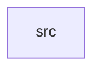

_Generated by CodeAtlas._

## Details

Owns 0 symbols across 1 file(s).

### src

Owns 11 symbols across 2 file(s).

**Related Classes/Methods:** _None_

**Source Files:**

- `crates/statguardian-metrics/src/report.rs`
  - `crates.statguardian-metrics.src.report.CheckResult`
  - `crates.statguardian-metrics.src.report.DatasetHealthScore`
  - `crates.statguardian-metrics.src.report.DatasetHealthScore.compute`
  - `crates.statguardian-metrics.src.report.ExecutionSummary`
  - `crates.statguardian-metrics.src.report.ExecutionSummary.fmt`
  - `crates.statguardian-metrics.src.report.ValidationReport`
  - `crates.statguardian-metrics.src.report.ValidationReport.new`
  - `crates.statguardian-metrics.src.report.ValidationReport.summary`
  - `crates.statguardian-metrics.src.report.ValidationReport.to_json`
  - `crates.statguardian-metrics.src.report.ValidationReport.to_json_pretty`
  - `crates.statguardian-metrics.src.report.ValidationReport.to_prometheus`
