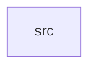

_Generated by CodeAtlas._

## Details

Owns 0 symbols across 1 file(s).

### src

Owns 33 symbols across 4 file(s).

**Related Classes/Methods:** _None_

**Source Files:**

- `crates/statguardian-stats/src/drift.rs`
  - `crates.statguardian-stats.src.drift.DriftEngine`
  - `crates.statguardian-stats.src.drift.DriftEngine.evaluate`
  - `crates.statguardian-stats.src.drift.DriftEngine.ks_statistic`
  - `crates.statguardian-stats.src.drift.DriftEngine.psi`
  - `crates.statguardian-stats.src.drift.DriftResult`
  - `crates.statguardian-stats.src.drift.bucket`
  - `crates.statguardian-stats.src.drift.compute_stat`
  - `crates.statguardian-stats.src.drift.evaluate_rule`
  - `crates.statguardian-stats.src.drift.is_numeric`
  - `crates.statguardian-stats.src.drift.quantile_manual`
  - `crates.statguardian-stats.src.drift.tests.make_series`
  - `crates.statguardian-stats.src.drift.tests.test_ks_identical_distributions`
  - `crates.statguardian-stats.src.drift.tests.test_ks_very_different_distributions`
  - `crates.statguardian-stats.src.drift.tests.test_psi_identical_distributions`
  - `crates.statguardian-stats.src.drift.to_f64_vec`
- `crates/statguardian-stats/src/hll.rs`
  - `crates.statguardian-stats.src.hll.HyperLogLog`
  - `crates.statguardian-stats.src.hll.HyperLogLog.add`
  - `crates.statguardian-stats.src.hll.HyperLogLog.add_str`
  - `crates.statguardian-stats.src.hll.HyperLogLog.cardinality`
  - `crates.statguardian-stats.src.hll.HyperLogLog.default`
  - `crates.statguardian-stats.src.hll.HyperLogLog.hash`
  - `crates.statguardian-stats.src.hll.HyperLogLog.new`
  - `crates.statguardian-stats.src.hll.tests.test_hll_approximate_cardinality`
  - `crates.statguardian-stats.src.hll.tests.test_hll_empty`
- `crates/statguardian-stats/src/profiler.rs`
  - `crates.statguardian-stats.src.profiler.ColumnProfile`
  - `crates.statguardian-stats.src.profiler.DatasetProfile`
  - `crates.statguardian-stats.src.profiler.Profiler`
  - `crates.statguardian-stats.src.profiler.Profiler.profile`
  - `crates.statguardian-stats.src.profiler.build_histogram`
  - `crates.statguardian-stats.src.profiler.is_numeric`
  - `crates.statguardian-stats.src.profiler.numeric_stats`
  - `crates.statguardian-stats.src.profiler.profile_column`
  - `crates.statguardian-stats.src.profiler.quantile_manual`
