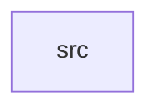

_Generated by CodeAtlas._

## Details

Owns 0 symbols across 1 file(s).

### src

Owns 17 symbols across 3 file(s).

**Related Classes/Methods:** _None_

**Source Files:**

- `crates/statguardian-validators/src/lib.rs`
  - `crates.statguardian-validators.src.lib.Violation`
  - `crates.statguardian-validators.src.lib.Violation.is_blocking`
  - `crates.statguardian-validators.src.lib.Violation.new`
  - `crates.statguardian-validators.src.lib.Violation.with_rows`
  - `crates.statguardian-validators.src.lib.Violation.with_values`
- `crates/statguardian-validators/src/rules.rs`
  - `crates.statguardian-validators.src.rules.RuleEngine`
  - `crates.statguardian-validators.src.rules.RuleEngine.evaluate`
  - `crates.statguardian-validators.src.rules.RuleEngine.evaluate_cross_column`
  - `crates.statguardian-validators.src.rules.compute_metric`
  - `crates.statguardian-validators.src.rules.evaluate_cross_column_rule`
  - `crates.statguardian-validators.src.rules.evaluate_rule`
  - `crates.statguardian-validators.src.rules.metric_name`
  - `crates.statguardian-validators.src.rules.row_matches`
- `crates/statguardian-validators/src/schema.rs`
  - `crates.statguardian-validators.src.schema.SchemaValidator`
  - `crates.statguardian-validators.src.schema.SchemaValidator.validate`
  - `crates.statguardian-validators.src.schema.check_constraints`
  - `crates.statguardian-validators.src.schema.check_type`
